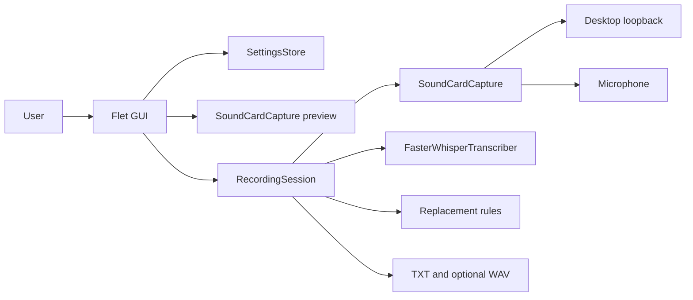
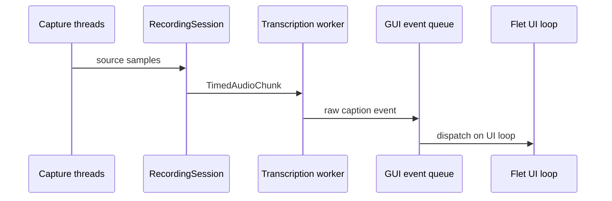

# Architecture

DeskScribeはGUI、録音調停、音声I/O、認識、永続化を分離したローカルアプリです。

音声は2本のキャプチャスレッドで取得され、`DualSourceBuffer` が同期します。
文字起こしは単一ワーカーがキューを順番に処理します。バックグラウンド結果は
GUIイベントキューを経由し、FletのUIループで反映されます。

重要な境界は、オフラインモデル限定、GUIとバックグラウンドスレッドの分離、
ライブ生テキストと保存時置換の分離です。
