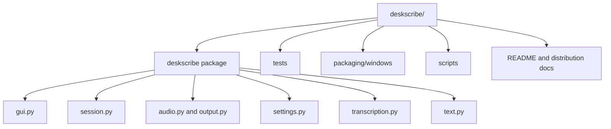

# Codebase Information

- 名称: DeskScribe
- 種別: Python 3.14 / Flet デスクトップGUI
- ソース: `deskscribe/` の8 Pythonファイル
- テスト: `tests/` の8 Pythonファイル、現在77テスト
- エントリポイント: `main.py`
- パッケージ管理: uv / `pyproject.toml` / `uv.lock`
- 配布: PyInstallerによるWindows windowed one-file EXE

生成物、モデル、録音ファイル、キャッシュはコードベース分析対象外です。
