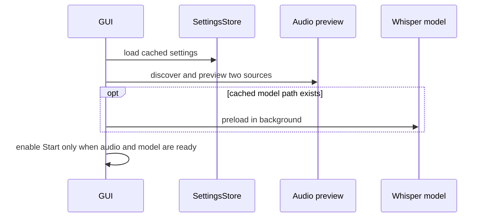

# Workflows

## 起動と準備

## 録音と保存

1. GUIが辞書を解析し、プレビューを停止します。
2. `RecordingConfig` と `RecordingSession` を生成します。
3. 2系統音声をチャンク化し、単一認識ワーカーへ渡します。
4. 生の認識結果をライブ表示し、同じ生テキストを次チャンクの文脈に使います。
5. 停止時に残りのキューを処理し、各本文へ辞書を適用してTXTを保存します。
6. WAV有効時だけ全チャンクを結合して保存し、GUIにファイルリンクを表示します。

## 設定変更

歯車ダイアログで詳細値を選ぶとJSONへ保存されます。beam sizeまたはCPUスレッドを
変えるとモデルを再読込し、処理秒数と文脈長は次回録音へ反映します。

## Windows配布

`scripts/build_windows.ps1` がテストとRuff、Fletクライアント準備、PyInstaller、
ライセンス文書コピー、ZIP、SHA-256生成を順番に実行します。
